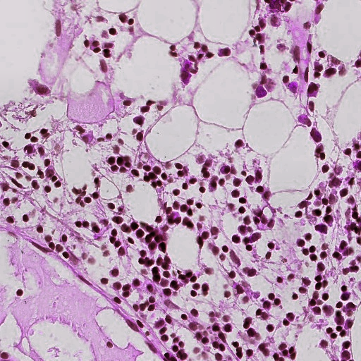
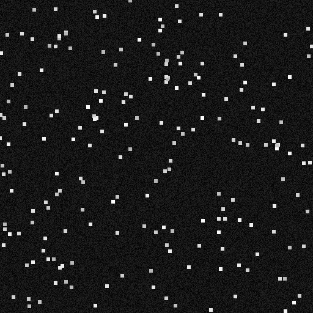

# H&E ↔ DAPI Virtual Staining Translator

Bi-directional virtual staining for histopathology: **H&E (RGB) ↔ DAPI (grayscale)**, for single patches and whole-slide images (WSI). Paired Pix2Pix + unpaired CycleGAN, FastAPI backend, drag-and-drop frontend, Docker deploy.

 [](https://github.com/urbiologicalpa/he-dapi-translator/actions) [](LICENSE) [](pyproject.toml) [](https://img.shields.io/badge/trained%20on-3.7GB%20CPU-critical) [](https://img.shields.io/badge/status-actively%20building-orange) [](CONTRIBUTING.md)

> 🚧 **Actively building in public** — model training live (**181/200 epochs**, 90.5%), roadmap in [Issues](https://github.com/urbiologicalpa/he-dapi-translator/issues), milestones as [Releases](https://github.com/urbiologicalpa/he-dapi-translator/releases). Contributors welcome — start with [CONTRIBUTING.md](CONTRIBUTING.md).

> **Why this repo stands out:** the product-grade model (3,717 images, 512px, ngf64/9-block generator, 200 epochs) is being trained **on a 3.7GB RAM, CPU-only laptop** — via streaming-by-default engineering (10.6GB → 140MB pack peak, 4.8GB → 512MB WSI budget) with crash-resume safety across reboots. See [the constraint story](#engineering-under-constraints).

| H&E input | DAPI target |
|---|---|
|  |  |

## Quickstart

Choose either the local Python environment or Docker. The commands below use the bundled example image.

### Option A: Local Python environment (CPU)

Requirements: Python 3.10+ and Git. Run these commands from a terminal at the repository root:

```bash
git clone https://github.com/urbiologicalpa/he-dapi-translator.git
cd he-dapi-translator
python -m venv .venv
```

**Linux / macOS (bash or zsh):**

```bash
source .venv/bin/activate
python -m pip install --upgrade pip
python -m pip install torch==2.3.0 torchvision==0.18.0 --index-url https://download.pytorch.org/whl/cpu
python -m pip install -r docker/requirements.txt
mkdir -p output
PYTHONPATH=. python src/models/infer.py --input data/examples/he_example.png --direction he2dapi --out output/synth.png
```

**Windows PowerShell:**

```powershell
.\.venv\Scripts\Activate.ps1
python -m pip install --upgrade pip
python -m pip install torch==2.3.0 torchvision==0.18.0 --index-url https://download.pytorch.org/whl/cpu
python -m pip install -r docker/requirements.txt
New-Item -ItemType Directory -Force output
$env:PYTHONPATH = "."
python src/models/infer.py --input data/examples/he_example.png --direction he2dapi --out output/synth.png
```

For whole-slide images, use streaming mode and provide a local slide path (the example path must exist in your checkout):

```bash
PYTHONPATH=. python src/models/infer.py --input data/raw/wsi/CMU-1.svs --direction he2dapi --wsi --stream --out output/wsi.tiff
```

### Option B: Docker inference

Requirements: Docker installed and running. This uses the published image and writes output to the host's `output/` directory. Run from the repository root.

**Linux / macOS:**

```bash
mkdir -p output
docker run --rm \
  -v "$PWD/output:/output" \
  ghcr.io/urbiologicalpa/he-dapi-translator:latest \
  python src/models/infer.py \
    --input /app/data/examples/he_example.png \
    --direction he2dapi \
    --out /output/synth.png
```

**Windows PowerShell:**

```powershell
New-Item -ItemType Directory -Force output
docker run --rm -v "${PWD}/output:/output" ghcr.io/urbiologicalpa/he-dapi-translator:latest python src/models/infer.py --input /app/data/examples/he_example.png --direction he2dapi --out /output/synth.png
```

The command after the image name overrides the image's default FastAPI-server command and runs the inference script instead. The image includes `data/examples/he_example.png`; see [`docker/Dockerfile`](docker/Dockerfile) and [`docker/`](docker/) for the container setup.

To start the API server instead, use:

```bash
docker run --rm -p 8000:8000 ghcr.io/urbiologicalpa/he-dapi-translator:latest
```

Then check `http://localhost:8000/health`.

### Important: trained model weights

The commands above exercise the inference pipeline, but **they do not guarantee trained-model predictions** unless a compatible checkpoint or ONNX file is available and supplied. The current inference script can fall back to an untrained model or a simple dummy transform when weights are missing. Review available weights on the [Hugging Face model page](https://huggingface.co/urbiologicalpa/he-dapi-translator), then pass the local file with `--checkpoint /path/to/checkpoint.pt` or `--onnx /path/to/model.onnx`. The Docker image excludes local checkpoint files, so mount downloaded weights into the container before passing their container path.

### More development commands

```bash
# Resumable training (requires the training dataset and configuration)
PYTHONPATH=. python -m src.models.train_paired --config configs/hemit_dual_branch.yaml --resume auto --optimize-for lowram

# Tracker and resource guards
PYTHONPATH=. python -m src.utils.progress_tracker --check
PYTHONPATH=. python -m src.utils.progress_tracker --enforce
PYTHONPATH=. python tests/test_resource_guards.py
```

Training configuration examples are in [`configs/`](configs/).

## 🔬 Live demo

Try the trained model **in your browser** — no install, inference runs client-side via ONNX Runtime Web:

[](https://huggingface.co/spaces/urbiologicalpa/he-dapi-translator) [](https://huggingface.co/urbiologicalpa/he-dapi-translator)

- **Space (demo):** https://huggingface.co/spaces/urbiologicalpa/he-dapi-translator
- **Weights (model card):** https://huggingface.co/urbiologicalpa/he-dapi-translator
- **Container:** `ghcr.io/urbiologicalpa/he-dapi-translator:latest` (also `:v0.1.0`)

## 📦 Install / Python API

> ⚠️ **Alpha / building:** the pip packages ship the `he2dapi` direction only; `dapi2he` lands with the unpaired model. APIs may change. Not for clinical use.

```bash
pip install he-dapi           # inference library + CLI
pip install napari-he-dapi    # napari plugin (in-viewer translation)
he-dapi translate -i he.png -o dapi.png -d he2dapi
```

```python
from he_dapi import translate

pred = translate("he.png", direction="he2dapi")  # -> uint8 HxW numpy array
```

## 🔨 Build progress (live training — 181/200 epochs)

| Metric | Value | Detail |
|---|---|---|
| Progress | **181/200 epochs (90.5%)** | resumable, per-epoch atomic checkpoints |
| G-loss | **2.2603 → 1.5302 (−32%)**, still falling | best-ep169, no divergence |
| D-loss | **~0.75 stable** | balanced GAN, no collapse/mode-collapse |
| Val PSNR | **29.3 dB** (peak 29.8) | offline eval, N=30 val |
| Nuclei Dice | 0.03 → 0.11 (late gain, still climbing) | StarDist pseudo-labels, thresh 0.1 |
| Pace | ~2.4h/epoch CPU | ETA full 200 ≈ Oct-20 |

Full history: [`docs/TRACKER.md`](docs/TRACKER.md) (human log) + [`docs/progress.json`](docs/progress.json) (machine-readable) — kept in sync after every milestone.

## Architecture

- **H&E→DAPI (paired):** dual-branch Pix2Pix (CNN-ResNet + Swin-Transformer + FMF fusion) + PatchGAN, loss = GAN + 100×L1 + SSIM + nuclei-Dice aux
- **DAPI→H&E (unpaired):** CycleGAN fallback for unaligned sections
- **Data:** HEMIT 5,292 pairs (3717 train / 630 val / 945 test, 512px) + MHIST/BCI for unpaired
- **Inference:** per-tile streaming WSI translation (no full-slide canvas), ONNX export

## Engineering under constraints (3.7GB box, no GPU)

Every stage profiled with `src/utils/resource_monitor.py`, every spike fixed by streaming, every fix locked by a regression guard (`tests/test_resource_guards.py`, 11 green):

| Spike | Fix |
|---|---|
| H5 pack 10.6GB concat OOM | chunked copy B=100, peak 140MB |
| WSI canvas 4.8GB | memmap `merge_tiles_streaming`, 512MB budget |
| VGG DISTS 400MB on CPU | disabled → L1+SSIM fallback |
| 8 workers × RAM duplication | `num_workers 0`, batch 2 + grad-accum 4 (eff. 8) |
| Reboots killing days of work | atomic `checkpoint_last.pt` + `--resume auto` + cron `boot_launch.sh` supervisor |

A Kaggle T4 offload was attempted, measured (CPU-only quota, 2.8h/ep — *slower* than local), and stood down with a written post-mortem instead of sunk cost. Process notes: [`wiki/`](wiki/) (9 optimization tracks), [`docs/optimization/REPORT.md`](docs/optimization/REPORT.md).

## Layout

```text
configs/                 training configs (product + lowram demo)
src/models/              datasets, losses, Pix2Pix + CycleGAN trainers, inference
src/utils/                resource monitor, tiling, WSI loader, stain-norm, progress tracker
src/backend/              FastAPI inference server (429 throttling)
src/frontend/             drag-and-drop UI
pack_hemit.py / pack_bci.py / hemit_extract.py   streaming dataset builders (repo root)
he-dapi-product-gpu-train.py                    Kaggle GPU offload script (stood down, see post-mortem in TRACKER)
resources/                dataset scripts, model cards, papers
docs/                     WORKPLAN, TRACKER, progress.json, metrics, reports
wiki/                     per-stage optimization notes (the constraint story)
tests/                    resource-guard regression tests (mirrored in CI)
.github/workflows/        ci.yml (guards) + cd-staging.yml + cd-production.yml (GHCR)
```

## Roadmap

- [x] Data pipeline (HEMIT/BCI/MHIST, streaming)
- [ ] Paired training to 200/200 (**181/200 now**)
- [ ] Full 630-val + test eval (SSIM/PSNR/Dice gate)
- [ ] Drag-and-drop tool polish (queue + websocket WSI progress)
- [ ] Docker Hub deploy
- [ ] Hugging Face Space live demo

## Author

**Bikash Kumar** — [@urbiologicalpa](https://github.com/urbiologicalpa) · [urbiologicalpaa](https://github.com/urbiologicalpaa) · Python/R/SQL, biotech × data. Open to collaboration and roles in ML / computational biology.
